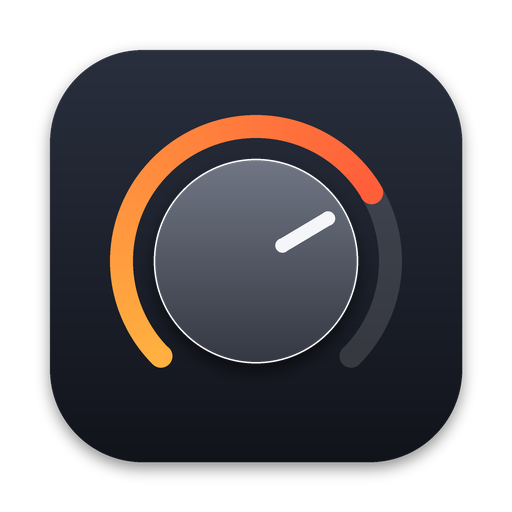

# MiniEQ

A tiny menu-bar equalizer for everything your Mac plays: **Volume, Balance, Bass, Mid, Treble.**

**[Website](https://thisfunction.github.io/MiniEq/)** · **[Download MiniEQ-1.0.dmg](https://github.com/thisFunction/MiniEq/raw/main/dist/MiniEQ-1.0.dmg)** · macOS 14.4+, Apple Silicon and Intel

## Using it

- Click the knob icon in the menu bar.
- **Drag** a knob up or down (hold **Option** for fine moves), or **scroll** over it. **Double-click** resets it.
- **Volume** is MiniEQ's own volume layer, on top of your Mac's normal volume. It also works on HDMI monitors and TVs where the Mac's volume keys don't.
- The **green dot** at the bottom means sound is passing through MiniEQ.
- **Quit** turns the effect off. Your Mac's sound goes back to normal right away.

## Building and installing

You need macOS 14.4 or newer and Apple's command-line tools. Install the tools once with `xcode-select --install`.

```bash
cd ~/Development/MiniEQ
./build.sh install
```

This builds `MiniEQ.app`, copies it to Applications and opens it. Run the same command again after changing the code.

## Sharing it with others

```bash
./build.sh dmg
```

This creates `dist/MiniEQ-1.0.dmg`, which works on both Apple Silicon and Intel Macs running macOS 14.4 or newer. Inside are the app, a shortcut to Applications for drag-to-install, and a "Read Me First" for whoever receives it.

MiniEQ isn't notarized by Apple, so people have to approve it once: System Settings → Privacy & Security → **Open Anyway**. Signing it with a paid Apple Developer ID and notarizing it removes that step.

## First launch

macOS asks to let MiniEQ record system audio. Click **Allow**. MiniEQ needs this to pass your sound through its knobs. Nothing is recorded or saved.

If you clicked **Don't Allow**, open System Settings → Privacy & Security → Screen & System Audio Recording. Turn on MiniEQ under **System Audio Recording Only**, then relaunch MiniEQ.

## Good to know

- **Quit eqMac** while using MiniEQ, so two equalizers don't stack.
- **Video calls:** if people hear an echo of themselves, quit MiniEQ during the call. macOS echo cancellation can't see re-routed audio.
- **Start at login:** System Settings → General → Login Items → add MiniEQ.
- **If sound ever goes silent after a crash:** open MiniEQ and quit it again. It cleans up leftovers on launch. As a last resort, `sudo killall coreaudiod` restarts the Mac's audio system.
- **Changing where the knobs act:** edit the `Tone` constants in `Sources/DSP.swift`, then rebuild.

## How it works

1. A Core Audio *process tap* captures everything every app plays (except MiniEQ itself) and mutes the original. This API is built into macOS 14.4 and later.
2. A private *aggregate device* pairs that tap with your real output device.
3. MiniEQ's real-time audio callback applies the knobs and plays the result on your device:
   - Bass: low shelf at 120 Hz, ±12 dB
   - Mid: bell at 1 kHz, ±12 dB
   - Treble: high shelf at 8 kHz, ±12 dB
   - Then balance, volume, and a gentle limiter that stops big boosts from clipping harshly.

There are no drivers to install and no admin password. eqMac 1.9 uses the same Apple API on newer macOS. When you switch outputs (headphones, AirPods, HDMI), MiniEQ follows automatically.

Diagnostic log: `log show --last 10m --predicate 'subsystem == "com.skoczylas.MiniEQ"'`
